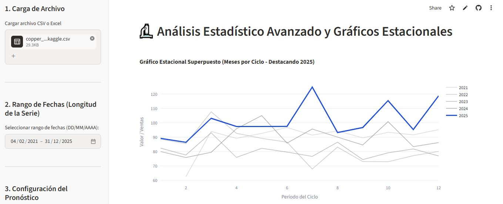
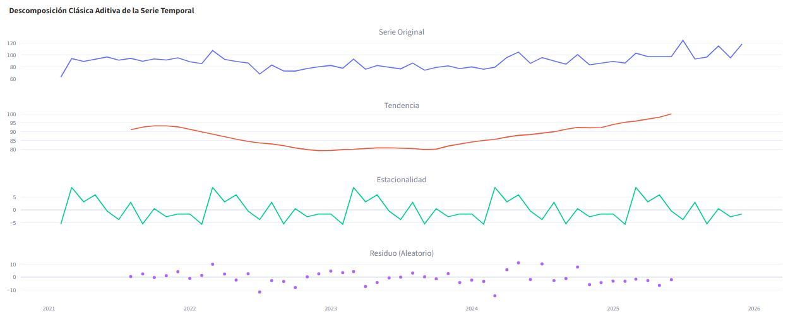
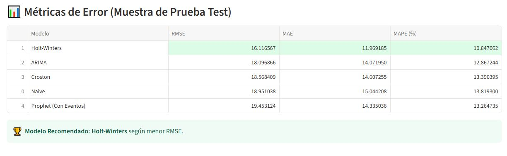

<div align="center">

# 📈 Time Series Forecasting & Analytics Platform

<p align="center">
  <em>Plataforma interactiva de series temporales · Pronóstico multi-modelo · Detección de anomalías · Festivos de Colombia</em>
</p>

<p align="center">
  
  
  
  
  
</p>

<br>



</div>

---

## ¿Qué hace esta aplicación?

**Time Series Forecasting & Analytics Platform** es una aplicación web interactiva construida en Python y Streamlit diseñada para analizar datos históricos (ventas, demanda, métricas operativas) y proyectar valores futuros con precisión estadística.

A diferencia de los scripts tradicionales que requieren configurar cada algoritmo manualmente, esta plataforma **automatiza el preprocesamiento, evalúa múltiples modelos en paralelo y selecciona el ganador** basándose en el menor error cuadrático medio ($RMSE$).

---

## Características Principales

* **📂 Carga e Imputación Inteligente:** Soporta archivos `.csv` y `.xlsx`. Aplica continuidad natural para frecuencias diarias y agrupación robusta por semanas ISO (lunes a domingo) evitando caídas artificiales en los bordes.
* **🇨🇴 Calendario de Festivos y Eventos Móviles:** Integra automáticamente los días festivos oficiales de Colombia (`holidays`) y permite añadir eventos personalizados (como *Semana Santa* o promociones) con ventanas de impacto previas y posteriores.
* **🔬 Diagnóstico Estadístico Avanzado:**
  * Gráficos estacionales superpuestos por ciclo.
  * Descomposición clásica aditiva (Tendencia, Estacionalidad y Residuo).
  * Prueba de estacionariedad Dickey-Fuller Aumentado ($ADF$) y gráficos de autocorrelación ($ACF$).
* **🚨 Detección de Anomalías:** Identifica valores atípicos automáticamente en el histórico utilizando **Isolation Forest**.
* **🏆 Torneo Automático de Modelos (Split 80/20):** Entrena y valida cinco enfoques distintos comparando sus métricas ($RMSE$, $MAE$ y $MAPE$):
  1. **Naive** (Línea base)
  2. **Holt-Winters** (Suavizamiento exponencial)
  3. **ARIMA / SARIMAX**
  4. **Croston** (Especializado en demanda intermitente o con muchos ceros)
  5. **Prophet** (Con estacionalidad y festivos de Colombia)
* **📥 Exportación Ejecutiva:** Genera un libro de Excel descargable con las métricas de evaluación, los valores proyectados, intervalos de confianza al 95% y el listado de festivos aplicados.

---

## Vista Previa del Flujo Analítico

<div align="center">
  <table>
    <tr>
      <td align="center">
        
        <br>
        <sub><b>1. Diagnóstico y Descomposición Estacional</b></sub>
      </td>
      <td align="center">
        
        <br>
        <sub><b>2. Torneo de Modelos y Proyección al 95%</b></sub>
      </td>
    </tr>
  </table>
</div>

---

## Instalación y Uso Local

### 1. Clonar el repositorio
```bash
git clone https://github.com/tu-usuario/tu-repositorio.git
cd tu-repositorio
```

### 2. Instalar dependencias
Asegúrate de tener Python 3.10 o superior instalado y ejecuta:
```bash
pip install streamlit pandas numpy plotly openpyxl xlsxwriter holidays statsmodels scikit-learn prophet
```

### 3. Ejecutar la plataforma
Inicia el servidor local de Streamlit apuntando a tu script:
```bash
streamlit run series.py
```

---

## Estructura de Datos Requerida

Para utilizar la aplicación, sube un archivo **CSV** o **Excel** desde el panel lateral que contenga al menos dos columnas:

| Fecha | Ventas |
| :--- | :---: |
| `01/01/2025` | `1540` |
| `02/01/2025` | `1620` |
| `03/01/2025` | `1490` |

> **Nota:** El formato de fecha recomendado es `DD/MM/AAAA`. La plataforma limpiará valores nulos y ordenará la serie cronológicamente de forma automática.
